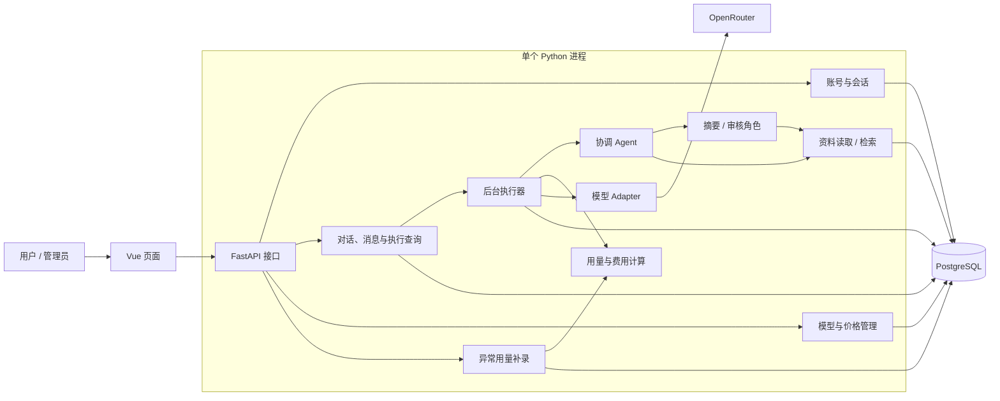
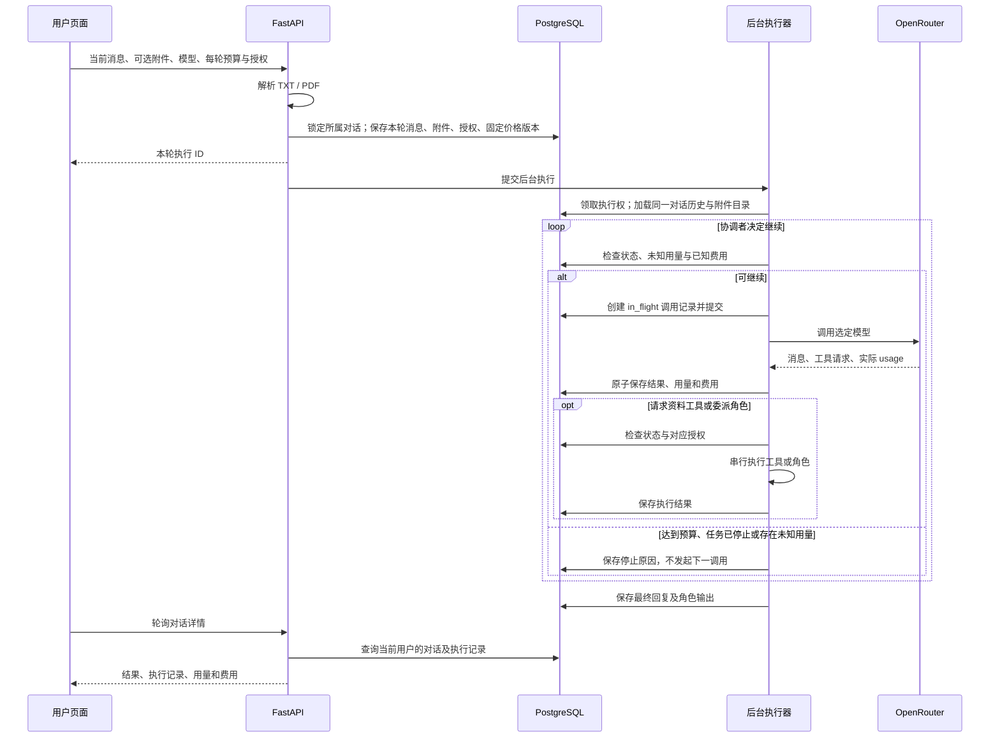
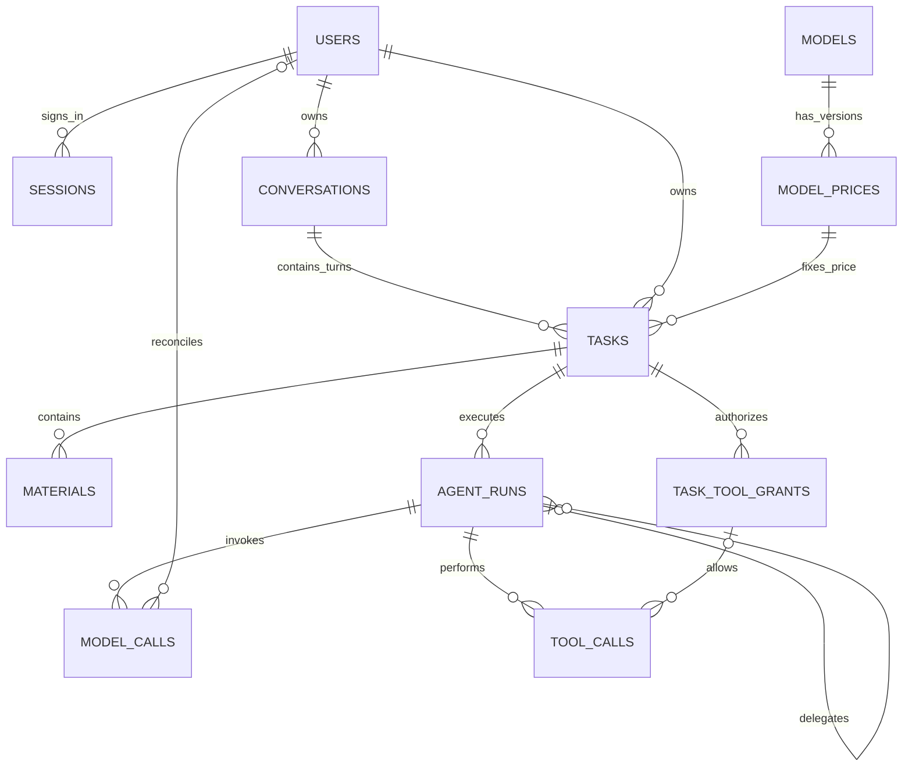

# Agent Desk 系统架构

## 1. 系统边界

Agent Desk 是支持资料处理的 AI 对话系统，由用户端、管理端、后端服务、关系数据库和模型提供商组成。

用户端负责连续对话、TXT / PDF 附件、执行状态及用量展示。管理端负责模型目录、价格版本和异常用量补录。后端维护对话上下文，协调固定 Agent 角色与资料工具，并记录每次模型调用的用量和费用。

对话是上下文与资料的隔离边界；每轮消息对应独立执行，固定模型、价格版本、预算和工具授权。费用记录采用版本化费率计算，不承担支付结算职责。

## 2. 总体架构

### 2.1 模块化单体与分层

Vue 3 + TypeScript 负责页面，FastAPI 负责业务，PostgreSQL 保存状态、原文和费用。一个 Python 进程内使用后台线程执行任务，每个任务的调用严格串行。HTTP 接口、后台执行器和领域模块共享数据库，通过明确的模块接口协作。

后端模块职责：

| 模块 | 职责 |
| --- | --- |
| `auth.py` | Argon2id 密码哈希、注册登录、服务端会话、用户和管理员鉴权、CSRF 校验 |
| `catalog.py` | 模型目录、启用状态、价格版本；编辑费率新增版本，不覆盖历史 |
| `workspaces.py` | 对话列表、发送消息、上传、历史查询、每轮执行创建、停止和工具授权修改 |
| `materials.py` | TXT / PDF 文本提取，拒绝无法读取或无文本的资料 |
| `execution.py` | 任务领取、固定角色自主调度、工具授权、预算检查、模型调用和状态变化 |
| `provider.py` | OpenAI 兼容 HTTP 调用与供应商错误分类，默认不重试 |
| `billing.py` | token 口径校验、缓存计数、Decimal 费用计算，其他模块不自行计算金额 |
| `admin.py` | 未知用量查询及有依据的幂等补录 |
| `entities.py` | SQLAlchemy 关系模型与数据库约束 |
| `main.py` / `core` | 应用生命周期、配置、数据库连接、初始模型、退出及启动恢复 |
| `schema.py` | 数据库结构迁移 |
| `manage.py` | 管理员初始化入口，与公开注册分离 |

前端由 `App.vue` 组织账号、历史对话侧栏和页面选择，`AuthView` 处理登录注册，`ChatView` 处理消息时间线、输入和轮询，`TurnDetails` 展开单轮执行与费用，`AdminPanel` 处理管理功能。`api/client.ts` 集中请求、CSRF、接口类型和错误转换。页面不直接计算账单，不接触模型 API Key。

### 2.2 使用的模式

- **分层＋模块化单体**：HTTP 解析与业务执行分离，账号、对话、模型、执行和费用模块分别封装领域职责。
- **Adapter**：`ModelClient.chat` 隔离供应商协议。执行器通过统一接口提交消息和工具定义，Adapter 负责 HTTP 请求、响应解析与供应商错误分类。
- **显式状态转换**：任务和调用通过状态及条件更新控制执行流程。
- **事务和唯一约束**：控制任务领取、授权竞态、价格版本和补录幂等。

## 3. 执行流程

`Conversation` 是用户看到的持续对话；`Task` 是一轮用户消息及助手回复的执行记录。`instruction` 保存用户消息，`result` 保存助手最终回复。每轮发送时固定该轮模型和价格版本，所有角色共用；预算也独立按轮累计。历史回复不因切换模型或修改费率而改变。

每次执行将同一用户、同一对话此前的用户消息和助手最终回复传给模型；失败轮次传递未完成原因；角色中间输出单独保存在执行记录中。同一对话历史附件可在后续轮次读取，但每次读取都检查**当前轮次**的授权；撤销授权阻止后续工具读取，不能撤回已经进入模型或历史回复的内容。新对话不共享上下文和附件。

发送消息时锁定对话行，同一对话只允许一轮处于等待/执行中；取消后若仍有在途调用，也需等待其结算后才能发送下一条。不同对话可并发。前端每两秒轮询对话状态，回复完成后整体显示；对话历史由数据库持久化。

协调、摘要、审核是三个固定提示词角色，共用任务选定的模型。只有协调者能委派角色，角色不能递归创建角色。它们可以读取、检索当前对话已上传的资料；模型返回的工具名必须属于后端白名单。

工具为 `read_material` 和 `search_materials`。读取返回完整提取文本；检索返回首个匹配处附近的片段并附资料标识，需要全文时继续读取。角色委派记录为 `delegate_summary` / `delegate_review`，不需要额外的资料授权，但角色实际读取资料时仍要检查权限。

不自行设置输入输出 token 上限、工具调用次数或文件大小配额；模型上下文和输出限制由供应商控制。网络请求设置超时。无自动重试；超时可能已产生供应商用量，因此进入待核实。

同一任务内部串行，任务之间可并发。用户停止任务或撤销授权不能撤回已发出的请求；返回的用量仍然入账，后续调用停止。前端关闭不影响后台任务。

## 4. 数据模型与一致性

| 表 | 核心内容与约束 |
| --- | --- |
| `users` | 唯一用户名、密码哈希、user/admin 角色 |
| `sessions` | 用户、随机令牌哈希、CSRF token、过期时间；浏览器只保存 HttpOnly 会话 cookie |
| `models` | 唯一供应商模型标识、显示名称、启用状态；已有标识不可编辑 |
| `model_prices` | 模型、版本、币种、输入/输出/缓存费率及价格说明；模型＋版本唯一，历史版本不修改 |
| `conversations` | 所属用户、首条消息生成的标题、创建与最近发送时间 |
| `tasks` | 所属用户及对话、固定价格版本、用户消息、每轮预算、状态、助手回复与停止原因 |
| `materials` | 所属任务、来源名称/类型、完整提取文本；不接受任意本地文件路径 |
| `task_tool_grants` | 所属任务、工具名、有效期、撤销时间；任务＋工具唯一 |
| `agent_runs` | 所属任务、父执行、固定角色、指令、状态和输出 |
| `model_calls` | 执行、供应商请求 ID、调用及用量状态、token、费用、原始 usage、补录依据与操作者 |
| `tool_calls` | 执行、可选授权、工具名、参数、输出、成功/拒绝/失败状态 |

主键为 UUID 字符串，时间使用 UTC `TIMESTAMPTZ`，金额用 `NUMERIC(24,12)`。任务费用按已确认的调用费用汇总。价格通过不可变版本固定，调用经执行和任务关联该版本。

关键事务：

1. 创建一轮时锁定对话并校验上一轮已结算；领取执行权时锁定任务，仅 `pending` 可转为 `running`。
2. 发出模型请求前短事务保存调用记录，提交后才请求网络，不跨外部请求持有数据库锁。
3. 响应写入调用结果、usage 和费用使用同一事务；只有一次调用记录，不另生成重复账单。
4. 工具执行与授权修改都按“任务行 → 授权行”加锁，使每次资料读取有明确的授权判断时点。
5. 管理员补录按“任务行 → 调用行”加锁。已确认记录重复提交只返回原费用，不重复计费。
6. 用户查询、停止和授权变更均检查任务所属用户；管理员也不能通过普通任务接口读取别人的资料。

## 5. 费用与状态

费用使用 `Decimal` 计算，金额通过十进制字符串传递至前端：

`费用 = ((输入 token − 缓存 token) × 输入单价 + 缓存 token × 缓存单价 + 输出 token × 输出单价) / 1,000,000`

缓存 token 是输入的子集，不重复相加。推理 token 已计入供应商输出计数时不再次计费。缺失 usage、非法计数或存在缓存用量但无缓存费率，均不得按零结算。

预算是**软阈值**：每次调用前检查已知费用，达到预算就停止后续调用。最后一次调用允许超额。若该调用已形成最终结果，任务可完成并显示实际费用；若仍需继续调用，则停在预算状态。

| 任务状态 | 含义 |
| --- | --- |
| `pending` / `running` | 等待领取 / 正在执行 |
| `completed` | 已有最终结果且用量已确认 |
| `stopped_budget` | 需要继续调用，但费用已达到预算 |
| `stopped_permission` | 工具未获授权、已撤销或已过期 |
| `cancelled` | 用户主动停止；在途调用仍需结算 |
| `awaiting_usage` | 调用可能已发生但用量未确认；禁止继续调用 |
| `failed` | 明确失败且没有未决用量 |
| `interrupted` | 服务中断，或异常用量已核实但不恢复执行 |

供应商明确拒绝的客户端错误保留失败记录；网络中断、服务器错误或不完整响应按未确定结果处理。未知费用保存 `NULL`，页面显示“待核实”及已知小计。管理员只有在取得可靠依据后才补录，补录后保留执行终止状态。

重启时，遗留 `in_flight` 调用改为 `usage_unknown`，相关任务改为 `awaiting_usage`；其他未完成任务改为 `interrupted`。中断的执行不会自动重发模型请求。后台线程退出前尽量等待已发出请求返回并记录用量；强制终止则由下次启动识别未决调用。

## 6. 身份认证与权限边界

用户密码使用 Argon2id 哈希。服务端会话保存随机令牌哈希和过期时间，浏览器通过 HttpOnly、SameSite=Strict cookie 携带会话令牌。写接口校验 CSRF token 和请求来源。

公开注册只创建普通用户，管理员通过独立初始化入口创建。对话、资料、执行记录和操作接口均检查所属用户；管理权限用于模型维护及异常用量补录。

资料工具按“单轮执行＋工具”授权。每次执行读取或检索前检查授权是否存在、是否撤销及是否过期。模型返回的工具名和参数经过白名单及结构校验，角色委派只允许协调者调用预定义的摘要、审核角色。
