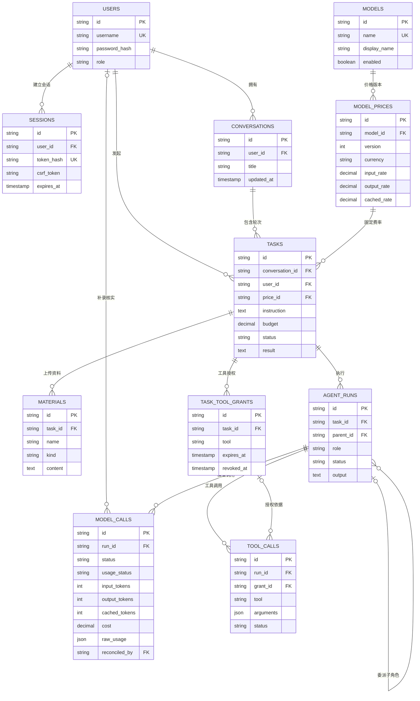

# Agent Desk 数据库设计与实现（2 号交付）

## 0. 交付清单

| 交付项 | 文件 | 内容 |
| --- | --- | --- |
| ER 图 | 本文第 2 节 | 11 张实体的关系、基数与外键 |
| 表结构 | `db/schema.sql`、本文第 3 节 | PostgreSQL 17 DDL、字段、约束、索引 |
| 样例数据 | `db/sample-data.sql` | 3 用户（含管理员） / 3 模型 / 4 轮次 / 6 次调用，覆盖完成、超预算、待核实、已停止 |
| 业务 SQL | `db/business-queries.sql` | 对话列表、轮次详情、费用汇总、待核实队列等 12 条 |
| 事务与扣费逻辑 | `db/transactions.sql`、本文第 6 节 | 6 个关键事务、扣费公式、软预算、幂等补录、启动恢复 |
| 数据库补齐迁移 | `db/migration.sql`、本文第 9 节 | 对 `create_all` 建立的库补齐枚举 CHECK 与复合索引 |
| 验收自查 SQL | `db/verification.sql`、本文第 10 节 | V1–V9 一致性断言 + V10 软预算观察 |

后端接口协同与本文的对应关系见第 7 节。本文是数据库设计的统一说明，不替代 spec 的行为定义。

## 1. 设计依据与范围

依据 `ARCHITECTURE.md` 与 `spec/*.md`：

- 对话是上下文与资料隔离边界；一轮消息对应一个 `tasks` 行，固定模型价格版本、预算与工具授权。
- 费用按模型实际返回的 token 和**创建轮次时锁定**的价格版本计算，历史账目不随现价变化。
- 用量未知时费用为 `NULL`，禁止记 0 或估算值。
- 不实现订阅、充值、积分、周期额度和支付结算；计费是**用量账目**，不是资金账户。

因此本设计没有 `wallets` / `balances` / `payments` 表。用户要求的“扣费逻辑”对应的是**调用成功后原子写入一次费用记录**，以及按轮累计判断软预算，而不是从余额扣减。

## 2. ER 图



关系要点：

- `model_calls → agent_runs → tasks → model_prices`：一次调用通过执行链固定到历史价格版本，改价不影响旧账。
- `tasks.conversation_id` 容许为空，用于兼容迁移前创建的旧轮次；新轮次必须属于对话。
- `agent_runs.parent_id` 自关联只允许协调者委派摘要 / 审核角色，不能递归创建角色。
- `tool_calls.grant_id` 可为空：角色委派类工具不需要资料授权；资料工具必须记录本次授权判断所依据的行。

## 3. 表结构

### 3.1 总览

| 表 | 用途 | 关键唯一 / 检查约束 |
| --- | --- | --- |
| `users` | 账号与角色 | `username` 唯一；`role IN ('user','admin')` |
| `sessions` | 服务端会话与 CSRF | `token_hash` 唯一；`expires_at` |
| `models` | 模型目录 | `name` 唯一；`enabled` |
| `model_prices` | 不可变价格版本 | `(model_id, version)` 唯一；费率非负 |
| `conversations` | 对话 | `user_id` 索引；`updated_at` 索引 |
| `tasks` | 一轮消息 / 执行 | `budget > 0`；9 种状态枚举 |
| `materials` | TXT / PDF / 粘贴文本 | `kind IN ('text','txt','pdf')` |
| `task_tool_grants` | 每轮每工具授权 | `(task_id, tool)` 唯一；工具白名单 |
| `agent_runs` | 协调 / 摘要 / 审核执行 | 角色与状态枚举；`parent_id` 自关联 |
| `model_calls` | 调用与用量账目 | `cost >= 0` 或 `NULL`；`cached_tokens <= input_tokens` |
| `tool_calls` | 资料工具 / 委派审计 | 状态枚举；`grant_id` 可空 |

主键统一 `VARCHAR(36)`（UUID 字符串），时间统一 `TIMESTAMPTZ`（UTC），金额统一 `NUMERIC(24,12)`。完整 DDL 见 `db/schema.sql`。

### 3.2 字段明细

**users**：`id` PK、`created_at`、`username` UK、`password_hash`（Argon2id PHC）、`role`（user/admin）。

**sessions**：`id` PK、`created_at`、`user_id` FK→users、`token_hash` UK（令牌 SHA-256，不明文）、`csrf_token`、`expires_at`。

**models**：`id` PK、`created_at`、`name` UK（供应商标识，创建后不可改）、`display_name`、`enabled`。

**model_prices**：`id` PK、`created_at`、`model_id` FK→models、`version`、`currency`（3 位字母）、`input_rate`、`output_rate`、`cached_rate`（可空）、`source_url`、`billing_note`；费率单位 USD/百万 token。

**conversations**：`id` PK、`created_at`、`user_id` FK→users、`title`（首条消息生成）、`updated_at`。

**tasks**：`id` PK、`created_at`、`conversation_id` FK→conversations（可空）、`user_id` FK→users、`price_id` FK→model_prices（本轮锁定）、`title`、`instruction`（用户消息）、`budget`、`status`、`result`（最终回复）、`reason`、`finished_at`。

**materials**：`id` PK、`created_at`、`task_id` FK→tasks、`name`、`kind`（text/txt/pdf）、`content`（提取全文）。

**task_tool_grants**：`id` PK、`created_at`、`task_id` FK→tasks、`tool`（read_material/search_materials）、`expires_at`、`revoked_at`。

**agent_runs**：`id` PK、`created_at`、`task_id` FK→tasks、`parent_id` FK→agent_runs（可空）、`role`（coordinator/summary/review）、`status`、`instruction`、`output`、`finished_at`。

**model_calls**：`id` PK、`created_at`、`run_id` FK→agent_runs、`provider_request_id`、`status`、`usage_status`（unknown/known）、`input_tokens`、`output_tokens`、`cached_tokens`、`cost`（NULL=未知）、`raw_usage` JSON、`response_text`、`error`、`reconciled_by` FK→users、`evidence`、`reconciled_at`、`finished_at`。

**tool_calls**：`id` PK、`created_at`、`run_id` FK→agent_runs、`grant_id` FK→task_tool_grants（可空）、`tool`、`arguments` JSON、`status`（completed/denied/failed）、`output`。

### 3.3 索引设计

| 索引 | 支撑的查询 |
| --- | --- |
| `ix_conversations_user_id`、`ix_conversations_updated_at` | 用户对话列表按最近更新排序 |
| `ix_tasks_conversation_id`、`ix_tasks_conv_created(conversation_id, created_at, id)` | 对话时间线、同对话历史上下文 |
| `ix_tasks_user_id`、`ix_tasks_status` | 用户任务列表、执行器扫描、互斥检查 |
| `ix_model_prices_model_id` | 查询最新价格版本 |
| `ix_materials_task_id`、`ix_task_tool_grants_task_id` | 资料目录与授权检查 |
| `ix_agent_runs_task_id`、`ix_agent_runs_parent_id` | 单轮执行详情、委派链 |
| `ix_model_calls_run_id`、`ix_model_calls_status` | 费用汇总、待核实队列、启动恢复 |
| `ix_tool_calls_run_id` | 工具审计展示 |

### 3.4 关键约束与设计取舍

- **价格不可变**：没有 `UPDATE model_prices` 的业务路径；改价插入新 `version`，唯一约束防止并发生成重复版本。
- **费用与用量状态联合约束**：`ck_model_calls_usage_complete` 强制 unknown 的费用为 NULL，known 的输入、输出、缓存 token 与费用全部非空；再由非负和缓存子集 CHECK 校验数值。仅有 `cost >= 0` 不能阻止未知费用被记为 0。
- **缓存 token 是输入子集**：`cached_tokens <= input_tokens` 由 CHECK 保证，计费公式不再重复相加。
- **金额用 NUMERIC 不用 float**：`Decimal(24,12)` 对应前端十进制字符串，避免累计误差。
- **不做资金余额表**：业务只记录费用账目；“扣费”是幂等的调用结算，不是账户扣款。

## 4. 样例数据

`db/sample-data.sql` 使用固定 ID，覆盖以下场景：

| 样例 | 说明 |
| --- | --- |
| `t-alice-1` / `call-01~03` | 完整完成的一轮：协调 + 摘要 + 审核，费用 0.00228 USD |
| `t-alice-2` / `call-04` | 软预算 0.0005，最后一次调用记 0.0014，任务 `stopped_budget` |
| `t-alice-3` / `call-05` | 网络中断，`cost = NULL`，任务 `awaiting_usage`，授权已过期 |
| `t-bob-1` / `call-06` | 用户停止 + 供应商明确拒绝，记已知零用量失败调用 |
| `p-minimax-v1/v2` | 同一模型两个价格版本，旧轮次仍引用 v1 |
| `tc-05/06/07` | 分别演示授权撤销、授权过期、未获授权的工具拒绝 |

样例密码哈希是占位字符串，仅用于展示字段形态，不能用于登录。

## 5. 业务 SQL

`db/business-queries.sql` 提供以下查询，参数用 `$1`、`$2` 占位，由应用绑定：

| 编号 | 查询 | 用途 |
| --- | --- | --- |
| Q1 | 用户对话列表 | 首页侧栏，按 `updated_at` 倒序 |
| Q2 | 对话时间线 | 一轮一条，含状态、费用小计 |
| Q3 | 单轮执行详情 | runs + 委派链 |
| Q4 | 单轮调用账目 | 逐次 token、费用、错误、补录依据 |
| Q5 | 单轮费用汇总 | 已知小计 + 未知调用数 |
| Q6 | 发送前互斥检查 | 活跃轮次 + 在途调用 |
| Q7 | 授权有效性检查 | 判断 `revoked_at` / `expires_at` |
| Q8 | 待核实队列 | 管理员补录入口 |
| Q9 | 价格版本历史 | 管理端展示改价轨迹 |
| Q10 | 用户累计费用 | 按模型与币种汇总 |
| Q11 | 对话内资料目录 | 模型可见的附件清单 |
| Q12 | 工具调用审计 | 区分成功、拒绝、失败 |

所有查询都带用户归属过滤（`user_id = $1`），管理员通过普通任务接口访问时也受同样约束。

## 6. 事务与扣费逻辑

### 6.1 加锁顺序总表

统一顺序：**对话行 / 任务行 → 授权行 / 调用行**。禁止反向加锁，避免死锁。

| 场景 | 加锁顺序 | 目的 |
| --- | --- | --- |
| 创建新一轮 | `conversation` FOR UPDATE | 同对话互斥，校验上一轮已结算 |
| 领取执行权 | `task` FOR UPDATE | 只有 `pending` 能转 `running`，只领取一次 |
| 调用前检查 | `task` FOR UPDATE | 预算与未知用量判定有稳定时点 |
| 响应结算 | `task` → `model_call` | 用量、费用、状态一次写入 |
| 工具执行 / 授权修改 | `task` → `task_tool_grant` | 每次读取有明确的授权判断时点 |
| 管理员补录 | `task` → `model_call` | 幂等，且不覆盖已确认账目 |

**关键原则**：任何数据库锁都不跨外部 HTTP 模型请求。发出请求前短事务提交 `in_flight` 记录，响应回来后另开事务结算。

### 6.2 六个关键事务

参数化事务步骤见 `db/transactions.sql`（分支判断及参数绑定由应用执行，不能直接整文件作为独立事务运行），这里给出要点：

1. **创建一轮**：锁对话 → 检查 `status IN ('pending','running')` 的轮次与 `in_flight` 调用 → 取模型最新价格版本 → 插入 `tasks` / `materials` / `task_tool_grants` → 更新对话标题与 `updated_at` → 提交后才启动后台执行。
2. **领取执行权**：`SELECT ... FOR UPDATE` 任务，`status = 'pending'` 才置 `running`；重复领取直接返回。
3. **调用前登记**：短事务锁任务并检查“是否存在 `usage_status='unknown'` 的调用”和“已知费用是否已达预算”，通过后插入 `model_calls(status='in_flight', usage_status='unknown')`，提交，然后调用供应商。
4. **响应结算**：同事务写入 `raw_usage` / token / `cost` / `status` / `usage_status`；只有一行调用记录，不另生成账单。用量非法或缺失时 `cost` 保持 `NULL`、状态置 `usage_unknown`，任务转 `awaiting_usage`。
5. **工具执行**：锁任务 → 锁授权行 → 判断撤销与到期 → 读取当前对话资料 → 写 `tool_calls`。任一项不满足即记录 `denied` 并停止本轮。
6. **管理员补录**：锁任务 → 锁调用行；`usage_status='known'` 直接返回原费用（`already_reconciled=true`）；`status <> 'usage_unknown'` 拒绝；否则用**原价格版本**计算并写入 token、费用、操作者、依据、时间。若该轮全部未知项已确认，把 `awaiting_usage` 改为 `interrupted`，不自动续跑。

### 6.3 扣费公式与精度

```
费用 = ((输入 token − 缓存 token) × 输入单价
        + 缓存 token × 缓存单价
        + 输出 token × 输出单价) / 1,000,000
```

- 缓存 token 是输入子集，不重复计费；推理 token 已含在供应商输出计数中时不另加。
- 计算使用 `Decimal`，存储 `NUMERIC(24,12)`，传输用十进制字符串。
- 以下情况**不得按 0 结算**：usage 缺失、计数非法、缓存计数 > 输入计数、有缓存 token 但价格版本 `cached_rate IS NULL`。这些情况 `cost = NULL`，任务进入 `awaiting_usage`。
- 供应商明确拒绝（4xx）可确定未产生用量，记已知 `0` 费用的失败调用；超时、5xx、响应格式异常一律待核实，不自动重试。

### 6.4 软预算

预算是**停止阈值**，不是预付额度：

- 每次调用前检查本轮已知费用合计 `SUM(cost) >= budget` 则不再发起新调用。
- 最后一次调用允许超额。若该调用已形成完整最终回复，任务可 `completed`；否则置 `stopped_budget`。
- 存在任何 `usage_status='unknown'` 的调用时优先停止，状态为 `awaiting_usage`。

### 6.5 幂等与并发

- 一次模型调用只有一条 `model_calls` 记录；请求前创建、响应后更新，不插入第二条“账单行”。
- 补录以 `usage_status='known'` 为幂等标记，重复提交返回原费用，不改已确认账目。
- 价格版本 `(model_id, version)` 唯一，并发改价只有一个成功。
- 授权 `(task_id, tool)` 唯一，并发撤销 / 开启作用于同一行。
- 同对话通过行锁串行；不同对话可并发。

### 6.6 启动恢复

服务重启时单事务处理：

- `model_calls.status = 'in_flight'` → `usage_unknown`，关联任务 → `awaiting_usage`（用量可能已产生）。
- 其余 `tasks.status IN ('pending','running')` → `interrupted`，`agent_runs.status='running'` → `interrupted`。
- 恢复逻辑不重发模型请求，不清除已确认费用。

## 7. 后端接口协同（2 号与 3 号）

### 7.1 模块与代码的对应

| 设计项 | 现有代码位置 | 状态 |
| --- | --- | --- |
| 实体与 ORM 映射 | `backend/app/entities.py` | 已实现 11 张表；本文 DDL 额外补枚举 CHECK 与复合索引 |
| 建表与兼容迁移 | `backend/app/main.py`、`backend/app/schema.py` | `create_all` + `upgrade_conversations` 增加 `conversation_id` |
| 费用计算 | `backend/app/billing.py` | `calculate()` 已实现 Decimal 公式与 `UnknownUsage` |
| 执行与事务 | `backend/app/execution.py` | 6 个事务的加锁顺序已实现 |
| 创建轮次 / 授权 / 查询 | `backend/app/workspaces.py` | 对话互斥、授权变更、详情查询 |
| 补录 | `backend/app/admin.py` | 幂等补录与待核实队列 |
| 模型与价格版本 | `backend/app/catalog.py` | 改价生成新版本 |

### 7.2 接口到数据表与事务的映射

下表是“后端接口由 2 号和 3 号协同完成”的逐项核查依据。前端只经这些接口访问数据库，不直接读写表；每行给出接口涉及的读写表、对应的事务或业务 SQL、以及数据库层必须守住的一致性要点。

**账号与会话**（`auth.py`）

| 接口 | 读写表 | 对应事务 / SQL | 一致性要点 |
| --- | --- | --- | --- |
| `POST /api/auth/register` | `users` INSERT；`sessions` INSERT | 单事务 | `username` 唯一；客户端角色不生效，`role` 只能为 `user` |
| `POST /api/auth/login` | `users` SELECT；`sessions` INSERT | 单事务 | 凭据错误不建立会话 |
| `GET /api/auth/me` | `sessions` + `users` SELECT | 只读 | 仅 `expires_at > now()` 的会话有效 |
| `POST /api/auth/logout` | `sessions` DELETE | 单事务 | 只删除当前会话 |

**模型与价格**（`catalog.py`）

| 接口 | 读写表 | 对应事务 / SQL | 一致性要点 |
| --- | --- | --- | --- |
| `GET /api/models` | `models` + `model_prices` SELECT | Q9 取最新价 | 只返回 `enabled = true` 的模型 |
| `GET /api/admin/models` | 同上（含停用） | Q9 | 管理员权限 |
| `POST /api/admin/models` | `models` + `model_prices`（v1）INSERT | 辅助 B | `(model_id, version)` 唯一；首个版本为 1 |
| `PUT /api/admin/models/{id}` | `models` UPDATE；新 `model_prices` INSERT | 辅助 B | 供应商标识不可改；改价追加版本，不覆盖历史 |

**对话与轮次**（`workspaces.py`）

| 接口 | 读写表 | 对应事务 / SQL | 一致性要点 |
| --- | --- | --- | --- |
| `GET /api/conversations` | `conversations` SELECT | Q1 | `user_id` 过滤，按 `updated_at` 倒序 |
| `POST /api/conversations` | `conversations` INSERT | 单事务 | `title` 初值为“新对话” |
| `GET /api/conversations/{id}` | `conversations` + `tasks` + 明细 | Q2、Q3、Q4、Q11、Q12 | `user_id` 过滤，逐轮返回执行与费用 |
| `POST /api/conversations/{id}/messages` | `tasks`、`materials`、`task_tool_grants` INSERT | T1 | 锁对话；活跃轮次或在途调用存在时拒绝 |
| `GET /api/tasks` | `tasks` + `model_calls` | Q5 | 兼容入口；仍按 `user_id` 过滤 |
| `POST /api/tasks` | 同消息接口 | T1 | 兼容入口；聊天页使用对话消息接口 |
| `GET /api/tasks/{id}` | `tasks`、`agent_runs`、`model_calls`、`tool_calls`、`materials`、授权 | Q3、Q4、Q11、Q12 | 单轮详情；角色中间输出与最终回复分开 |
| `POST /api/tasks/{id}/cancel` | `tasks` UPDATE | 辅助 A | 在途调用不置为失败，响应回来仍结算 |
| `PUT /api/tasks/{id}/grants/{tool}` | `task_tool_grants` UPSERT | T5 授权段 | 锁任务 → 授权行；到期时间须为未来 |

**管理与补录**（`admin.py`）

| 接口 | 读写表 | 对应事务 / SQL | 一致性要点 |
| --- | --- | --- | --- |
| `GET /api/admin/unresolved` | `model_calls` + `tasks` + `users` + `model_prices` | Q8 | 仅管理员；返回补录所需原价格费率 |
| `POST /api/admin/calls/{id}/reconcile` | `model_calls` + `tasks` UPDATE | T6 | 锁任务 → 调用行；已确认调用幂等返回，不重复计费 |

**协同边界**：接口层负责身份、权限与参数校验，事务脚本负责加锁顺序与状态流转，数据库约束负责最终兜底（枚举、唯一、非空、非负）。三者不重复计算费用：金额只在 `billing.calculate()` 中按固定价格版本计算一次，接口只读取 `model_calls.cost`。若以 `db/schema.sql` 初始化数据库（而非 `create_all`），枚举 CHECK 会生效；已有库按第 9 节迁移补齐。

## 8. 验收对照

| spec 条款 | 数据库层面的支撑 |
| --- | --- |
| ACC-01/03/04/05 | `users` 唯一约束、`role` CHECK、全表 `user_id` 过滤、`token_hash` 不明文 |
| MODEL-01/02/03/04 | `models.name` 唯一 / `enabled`、`model_prices` 版本唯一与非负 CHECK |
| MAT-02/04/05 | `materials` 归属 + `task_tool_grants` 有效期 / 撤销字段、`tool_calls` 审计 |
| EXEC-03/04/08 | `tasks.status` 与 `agent_runs.status` 枚举、`model_calls.status` 枚举 |
| BILL-01/02/03/06/07 | `model_calls` 全字段、`cost` 可空、补录审计字段、`usage_status` 幂等标记 |

## 9. 数据库初始化与迁移

### 9.1 初始化路径

| 场景 | 方式 | 结果 |
| --- | --- | --- |
| 全新数据库 | 执行 `db/schema.sql` | 11 张表 + 全部枚举 CHECK + 复合索引一次到位 |
| 现有 `create_all` 库 | 执行 `db/migration.sql` | 保留全部数据，仅补齐 CHECK 与索引 |
| 旧版无 `conversations` 的库 | `main.py` 启动时调用 `upgrade_conversations` | 增加 `tasks.conversation_id` 并接入旧任务 |

`db/schema.sql` 与 `backend/app/entities.py` 字段一一对应，主键、金额精度与 UTC 时间口径一致；差别只在 DDL 额外声明了枚举与业务 CHECK。应用侧写入的枚举值均在约束范围内，因此迁移不改变现有代码行为。

### 9.2 迁移顺序

1. 备份数据库。
2. 执行 `db/verification.sql` 的 V1–V9，确认无异常行；存在脏数据时先清洗。
3. 执行 `db/migration.sql`。DO 块按约束名判重，重复执行不会报错。
4. 再跑一次 V1–V9，确认约束生效且历史数据仍可查询；`db/sample-data.sql` 只导入独立演示或测试库，不导入已有用户数据的数据库。
5. 迁移不修改 `model_prices` 任何已有行；改价仍只追加新版本。

Compose 启动与依赖安装见 `DEVELOPMENT.md`，本文不重复运行步骤。

## 10. 验收自查

`db/verification.sql` 把第 8 节的 spec 条款落到可执行的数据库断言。V1–V9 均应返回 0 行；V10 返回的行表示软预算允许的最后一次超额，不是错误。

| 编号 | 检查内容 | 预期 |
| --- | --- | --- |
| V1 | 未知用量调用不得写入费用 | 0 行，`cost` 保持 `NULL` |
| V2 | 已知用量调用的 token 与费用完整 | 0 行 |
| V3 | 缓存 token 是输入 token 的子集 | 0 行 |
| V4a / V4b | `awaiting_usage` 有未确认调用；`completed` 无未确认调用 | 0 行 |
| V5a / V5b | 任务引用存在的价格版本；价格版本归属存在的模型 | 0 行 |
| V6 | 任务与对话同属一个用户 | 0 行 |
| V7 | 无孤立的执行、调用、工具、资料与授权记录 | 0 行 |
| V8 | 授权与价格版本唯一约束复核 | 0 行 |
| V9 | 预算为正 | 0 行 |
| V10 | 已知费用超过预算的轮次 | 允许有行，对应 BILL-04 |

数据库断言只覆盖 2 号可观测的一致性；业务流程正确性仍由 1 号按 spec 验收标准整体测试与验收，两者衔接处是：V1–V9 通过后，再按 `DEVELOPMENT.md` 第 5 节的验证重点执行端到端流程。


## 11. 统一启动与回归验证（2026-11-28）

应用启动及创建管理员都调用 `initialize_database`：创建缺失表、兼容旧对话结构、再执行同一份 `db/migration.sql`。也可先运行 `uv run python -m app.schema`。迁移按事务执行并使用当前 schema 的 advisory lock，发现违反新约束的旧数据时失败，不把未知费用自动改成 0，也不删除旧账。应用仍限定单进程部署。

`schema_translate_map` 对应的测试 schema 同时用于 ORM 和显式 SQL，避免测试操作落入 public。迁移目录必须随应用一起部署。约束与索引的一致性通过 PostgreSQL 系统目录比较；这不声称两种初始化路径所有服务端默认值完全相同。ORM 写入继续提供 Python 默认值。

回归入口及环境见 `DEVELOPMENT.md`。测试覆盖直接非法 SQL、合法零用量、重复初始化、旧结构迁移、脏数据阻断、原子回滚、并发补录、历史价格固定、重复补录不覆盖、并发发消息互斥、用户隔离、CSRF、未知用量和恢复不重发。测试模型通过 HTTP transport 模拟，不消费真实 API。

## 12. 关系设计与理论依据

- `users.id → username, password_hash, role`，username 也是候选键；`models.name` 与主键均可唯一识别模型。
- `model_prices.id → model_id, version, currency, rates`，`(model_id, version)` 是另一候选键。版本价格单独建表，防止现价更新覆盖任务的历史定价。
- `task_tool_grants.(task_id, tool) → expires_at, revoked_at`，通过复合唯一约束确保每轮每工具只有一份授权。
- 用户、模型价格、工具授权在这些已声明依赖下不存在非键属性对候选键的部分或传递依赖；技术主键本身不构成“所有表自动满足 3NF”的证明。
- `tasks` 对新轮次同时保存 conversation_id 与 user_id，而 conversation_id 决定所属用户，属于有意保留的归属冗余。当前一致性由接口写入和 V6 审计保证，普通单列外键不会阻止跨用户组合；因此不能宣称该冗余完全由数据库约束保护。未来可移除冗余或增加复合归属外键。
- `model_calls.cost` 是依据历史价格与 token 推导的账目快照。保存结果有利于审计，但与原始用量之间的公式一致性仍由计费函数与测试保证，不能仅靠非负 CHECK 证明。
- 原子性：一次补录的用量、费用、操作者和任务状态在同一事务提交；失败回滚。并发控制：同一对话创建新轮次先锁对话；补录先锁任务再锁调用；外部 HTTP 期间不持有数据库锁。
- `NULL` 表达“尚不可确认”，已知零费用是不同事实。汇总必须同时展示已知小计和未知调用数，不能将 `COALESCE(SUM(cost),0)` 单独解释成最终总账。
